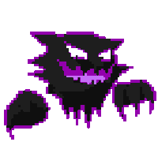

# Ciao, sono Giacomo 

**Studente di informatica · Cybersecurity · Software che gira in locale**

Scrivo programmi che girano sul tuo computer e non ti chiedono un account: 
traduttori offline, backup delle foto sul tuo server, un messenger su Tor.

---

### 📡 Dove trovarmi

---

### 🛠️ Cosa uso

**Linguaggi** 

**Database, runtime e framework** 

**Sistemi, hardware e tool** 

---

### 🚀 Progetti in evidenza

| | Progetto | Cosa fa | Stack |
|---|---|---|---|
| 🎙️ | [**Husky locale**](https://discordiahub.it/progetti/xiaozhi-local-server/) | Server vocale locale per ESP32 e HuskyLens 2 al posto del cloud xiaozhi.me | Python · Whisper · Ollama |
| 🌍 | [**Vetro**](https://discordiahub.it/progetti/vetro/) | Traduce schermo e voce fra IT/EN/RU/UK, tutto offline | Python · PySide6 · ONNX |
| 🧅 | [**OnionChat**](https://discordiahub.it/progetti/onionchat/) | Messenger desktop su Tor, senza server né account | Python · PyNaCl · Tor |
| 🔍 | [**Metadat**](https://discordiahub.it/progetti/metadat/) | Mostra i metadati nascosti di foto, video e documenti | Python · Tkinter |
| 🧹 | [**no-watermark**](https://discordiahub.it/progetti/no-watermark/) | Toglie caratteri invisibili e impronte dal testo delle chat AI | Rust · egui |
| 🔥 | [**forti-code**](https://discordiahub.it/progetti/forti-code/) | Plugin per Claude Code che gestisce firewall FortiGate via SSH | TypeScript · MCP |
| 🕹️ | [**VoidLoop**](https://discordiahub.it/progetti/voidloop/) | Sparatutto arcade neon con 6 settori e 6 boss | Python · pygame |
| 🗄️ | [**DBPeak**](https://discordiahub.it/progetti/dbpeak/) | Client desktop per MySQL, PostgreSQL e SQLite | Electron · Node.js |
| 🛡️ | [**BadHand**](https://discordiahub.it/progetti/badhand/) | Framework di test di rete con ~30 strumenti | Python · scapy |
| 🐕 | [**Cerberus Recon**](https://discordiahub.it/progetti/cerberus-recon/) | Scanner di rete multi-thread solo con la standard library | Python |

👉 **Tutti i progetti su [discordiahub.it](https://discordiahub.it/#progetti)**

---

### 🎯 Percorso certificazioni

→

→

